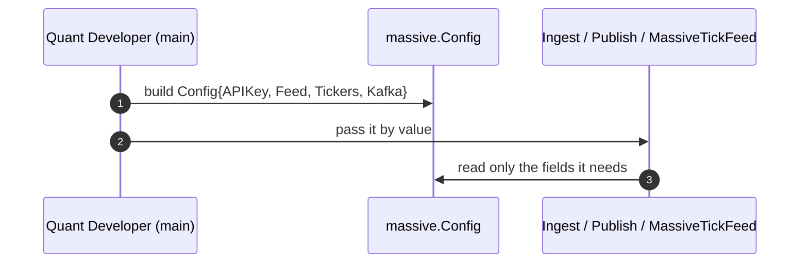

### TS-01 — Feed Configuration

## Index

| Section | Content |
|---|---|
| Header | Story fields |
| Functional Specification | Requirements, acceptance criteria |
| Technical Specification | Pointers, the struct, files, tips |
| Tasks | TASK-0101 |
| Known gaps & open points | No validation, no tests |
| Definition of Done | Checklist |

| Field | Value |
|---|---|
| **Type** | TS |
| **ID** | TS-01 |
| **Title** | Feed Configuration |
| **Architecture** | Ingestion |
| **Category** | Feature |
| **Priority** | Must |
| **Epic** | EP-02 |
| **Archetype** | service-change |
| **Actor** | Quant Developer |
| **Workflow** | --- |
| **Components** | `massive` |
| **Test Pyramid** | --- |
| **Complexity** | Low |
| **Jira Issue ID** | |

---

## Functional Specification

**As a** Quant Developer, **I want** one documented value that describes a Massive feed end to end, **so that** I can point the feed at different symbols or a different cluster without reading the implementation to find out what each parameter means.

### Functional Requirements

1. The configuration carries the Massive API key, the feed selector, the list of tickers to follow and the Kafka broker address of the Redpanda cluster.
2. The market is not configurable: this feed is always the stock market.
3. The subscription is exactly the configured ticker list. Nothing narrows it, nothing expands it.
4. Every field says, in its own doc comment, what it is for and what is expected in it.
5. The configuration is not validated. A wrong value surfaces as a connection error at runtime, not as a rejection up front.
6. The configured ticker strings are not rewritten: they reach the vendor exactly as written.

### Acceptance Criteria

1. The configuration value exposes exactly four parameters: API key, feed selector, ticker list and broker address.
   - Source evidence: `requirements/Massive_datafeed/analysis.md` · §9 `massive-config`, AS-1
2. Every one of the four carries a doc comment explaining its purpose and the shape of the expected value.
   - Source evidence: grill round 10 — "metti i commenti ai field della struct doc"
3. Configuring a lower-case ticker delivers it to the vendor in lower case; the uppercasing happens only when the topic name is built.
   - Source evidence: `requirements/Massive_datafeed/analysis.md` · §9 `topic-name`
4. Building the configuration performs no check and returns no error: there is nothing to call before using it.
   - Source evidence: grill round 10 — "leva pure la validazione"

### BDD Scenarios

`N/A — this story declares a type and carries no behaviour. The first observable behaviour is TS-02.`

---

## Technical Specification

> **Advisory only.** Non-binding; deviations get documented in the task implementation notes.

### Architecture Pointers

- New package boundary `massive/`, importing `github.com/totomz/gotrader` for `Symbol`, `Trade`, `Quote`, `MarketEvent`.
- Configuration is a plain struct, not a builder and not an env reader: gotrader is a library, so the caller's `main` decides where the values come from.
- The struct is shared by three consumers — ingester, producer, tick feed — which is why it is its own unit rather than a parameter list of the ingest function (`analysis.md` §2 rule F-6).
- There is no ticker pattern. R-3 asked for a regexp, but the SDK's `Subscribe` takes an explicit ticker list, so a pattern applied to a list the caller has already typed adds a failure mode and no capability (`analysis.md` §3 `out-of-scope-regexp`).
- There is no `Validate`. The doc comments carry what the caller needs to know, and a wrong value fails where it is used (`analysis.md` §3 `out-of-scope-config-validation`).

### Interaction Sequence



### Key Files / Modules

| Repo | Module | Key Files | Change Type | Effort |
|---|---|---|---|---|
| gotrader | massive | `massive/config.go` | Add | XS |

### Implementation Tips

- Keep `Feed` as the SDK's own type (`massivews.RealTime`) so the caller is not forced to learn a second vocabulary. The market is not configurable: this feed is always `massivews.Stocks`, hardcoded where the SDK client is built.
- Do not uppercase here. Topic naming uppercases at publish time; rewriting the symbol at configuration time would make the mapping to `gotrader.Symbol` lossy.
- The doc comments are the whole deliverable of this story. Write them for someone who has never seen the Massive SDK.

---

#### TASK-0101 — Config struct

| Field | Value |
|---|---|
| **Type** | TASK |
| **ID** | TASK-0101 |
| **Title** | Config struct |
| **Architecture** | Ingestion |
| **Category** | Feature |
| **Priority** | Must |
| Story | TS-01
| **Covers** | ---
| Task Kind | Dev |
| Test Level | --- |
| Jira Issue ID | |
| Repo | gotrader |
| Module | massive |
| Key Files | `massive/config.go` |
| Task Type | New |
| Complexity | XS — one struct and one conversion helper, no I/O, no branching. |
| Hours | 1 |
| Dependencies | --- |
| Blocked By | --- |

**Coding Suggestions:**

- **Approach:** Declare `type Config struct` with the four fields, each documented, plus `Symbols()` to hand the callers the tickers as framework symbols.
- **Where to modify:** New file `massive/config.go`; package declaration `package massive`.
- **Code sketch:**
  ```go
  // Config holds every parameter of a Massive realtime feed.
  //
  // The caller owns where these values come from: gotrader is a library and
  // never reads the environment on its own. The struct is passed by value to
  // Ingest, Publish and MassiveTickFeed, each of which reads the fields it
  // needs. Nothing here is validated: a wrong value surfaces as a connection
  // error where it is used.
  type Config struct {
      // APIKey authenticates the websocket session with Massive. The SDK sends
      // it during its own handshake; this package never logs it.
      APIKey string

      // Feed selects which stream to subscribe to, for example
      // massivews.RealTime. It is the SDK's own type on purpose, so the caller
      // does not have to learn a second vocabulary for the same concept.
      // The market is not configurable: this feed is always stocks.
      Feed massivews.Feed

      // Tickers is the exact subscription: these symbols and no others. There
      // is no pattern and no wildcard, because the SDK subscribes to an
      // explicit list anyway. The strings reach the vendor as written here;
      // the uppercasing happens only when the redpanda topic name is built.
      Tickers []string

      // Kafka is the host:port of the redpanda broker the events are written
      // to, and the one MassiveTickFeed reads them back from. One seed
      // address, not a list: there is no multi-broker bootstrap.
      Kafka string
  }

  // Symbols returns the configured tickers as framework symbols, in the order
  // the caller wrote them.
  func (c Config) Symbols() []gotrader.Symbol {
      symbols := make([]gotrader.Symbol, len(c.Tickers))
      for i, ticker := range c.Tickers {
          symbols[i] = gotrader.Symbol(ticker)
      }
      return symbols
  }
  ```
- **Patterns to reuse:** `gotrader.Symbol` from `strategy.go`; the exported-struct-with-plain-fields shape of `IBZippedCSV` and `GenericParquetTrades` in `datafeed.go`.
- **Watch-out-for:** Never log `APIKey`, not even truncated, in any of the three consumers.
- **Test guidance:** None. This story carries no test task by decision (grill round 10).

---

**Known gaps & open points:**

- R-3 asked for "la regexp di ticker da scaricare" and this story does not implement it (`analysis.md` §3 `out-of-scope-regexp`, grill round 7).
- There is no validation and no unit test (`analysis.md` §3 `out-of-scope-config-validation`, grill round 10). A blank API key, an empty ticker list, a duplicated ticker or a wrong broker address are all discovered at connection time: the duplicate in particular is silent, and writes every event of that ticker to Redpanda twice.

**Definition of Done:**
- [ ] Code reviewed and merged
- [ ] Tests added or updated per Test Pyramid
- [ ] BDD scenarios passing
- [ ] Acceptance Criteria verified end-to-end
