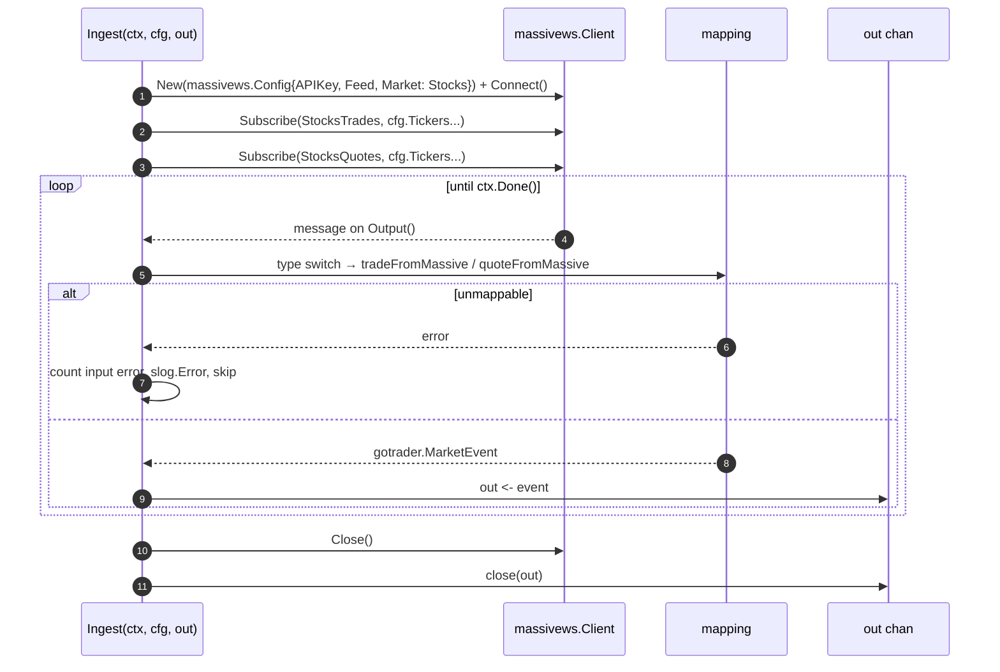

### TS-02 — Ingest Trades and Quotes from the Massive WebSocket

## Index

| Section | Content |
|---|---|
| Header | Story fields |
| Functional Specification | Requirements, acceptance criteria, BDD |
| Technical Specification | Pointers, sequence, mapping, files, tips |
| Tasks | TASK-0201, TASK-0202, UT-0201, E2E-0201 |
| Known gaps & open points | SDK assumptions |
| How to run these tests | Commands |
| Definition of Done | Checklist |

| Field | Value |
|---|---|
| **Type** | TS |
| **ID** | TS-02 |
| **Title** | Ingest Trades and Quotes from the Massive WebSocket |
| **Architecture** | Ingestion |
| **Category** | Integration |
| **Priority** | Must |
| **Epic** | EP-02 |
| **Archetype** | service-change |
| **Actor** | Quant Developer |
| **Workflow** | massive-ingest-pipeline |
| **Components** | `massive` |
| **Test Pyramid** | Unit, E2E |
| **Complexity** | Moderate |
| **Jira Issue ID** | |

---

## Functional Specification

**As a** Quant Developer, **I want** a function that holds the Massive connection and turns every incoming trade and quote into the framework's own market event, **so that** the rest of gotrader never sees vendor types and I can run the ingest half on its own.

### Functional Requirements

1. The ingest function connects to Massive with the configured credentials and subscribes to trades and quotes for the configured tickers only.
2. Every trade received becomes a trade market event carrying ticker, SIP timestamp, participant timestamp, sequence, price, size, exchange, tape and condition codes.
3. Every quote received becomes a quote market event carrying ticker, SIP timestamp, sequence, bid and ask price, size and exchange, condition, indicators and tape.
4. Events are handed off on a channel that never blocks the reader of the socket, whatever the downstream consumer is doing.
5. A frame that cannot be turned into a market event is counted, logged and skipped; the ingest keeps running.
6. The ingest function stops cleanly when its context is cancelled, and closes the handoff channel on the way out.
7. Reconnection after a dropped socket is whatever the vendor SDK does; the ingest function adds no retry of its own.

### Acceptance Criteria

1. With a configured ticker list of `AAPL, AMZN`, the feed receives events for those two symbols and for no other symbol.
   - Source evidence: `requirements/Massive_datafeed/analysis.md` · §5 `ingest-market-stream`, AS-2
2. Every field listed in the trade mapping table is carried from the incoming trade to the emitted market event, with no field left at its zero value when the source provided it.
   - Source evidence: `requirements/Massive_datafeed/analysis.md` · §9.1
3. Every field listed in the quote mapping table is carried from the incoming quote to the emitted market event.
   - Source evidence: `requirements/Massive_datafeed/analysis.md` · §9.2
4. A frame of an unexpected kind does not stop the ingest: the error count for that input rises by one and the following valid frame is still emitted.
   - Source evidence: `requirements/Massive_datafeed/analysis.md` · AS-5
5. The ingest function can be started, fed and observed without any Redpanda broker being reachable.
   - Source evidence: `requirements/Massive_datafeed/analysis.md` · AS-3, §7 `handoff-channel`
6. Cancelling the context ends the function and closes the handoff channel, so a consumer ranging over it terminates.
   - Source evidence: `requirements/Massive_datafeed/analysis.md` · §5 `ingest-market-stream`

### BDD Scenarios

```gherkin
Feature: Ingest trades and quotes from the Massive WebSocket

  Scenario: A live trade becomes a market event
    Given a valid Massive API key in MASSIVE_API_KEY
    And a configured ticker list of "AAPL"
    When the Quant Developer runs `go test ./massive/ -run TestIngestLive -v`
    Then at least one market event is received on the handoff channel within the test timeout
    And its ticker is "AAPL"

  Scenario: Vendor fields land on the framework types
    Given a recorded Massive trade frame with price, size, exchange, tape and condition codes
    When the Quant Developer runs `go test ./massive/ -run TestMapping -v`
    Then the resulting trade carries every field of the trade mapping table

  Scenario: A bad frame is skipped, not fatal
    Given a frame of an unexpected kind followed by a valid trade frame
    When the Quant Developer runs `go test ./massive/ -run TestMappingErrors -v`
    Then the input error count has risen by one
    And the valid trade is still produced

  Scenario: No API key, no test run
    Given MASSIVE_API_KEY is not set
    When the Quant Developer runs `go test ./massive/`
    Then the live ingest test is skipped and the package still passes
```

---

## Technical Specification

> **Advisory only.** Non-binding; deviations get documented in the task implementation notes.

### Architecture Pointers

- The vendor SDK `github.com/massive-com/client-go/v3/websocket` is imported by this story and by nothing else in the repository. The mapping functions are the boundary: past them, only `gotrader.Trade`, `gotrader.Quote` and `gotrader.MarketEvent` exist.
- Auth, subscribe framing and reconnect are the SDK's responsibility by decision (`analysis.md` §11 `availability`), so this package holds no backoff loop.
- The handoff is one plain buffered channel and nothing else (`analysis.md` §7 `handoff-channel`). No wrapper type, no pump goroutine: `Ingest` sends, `Publish` receives. The buffer is `handoffBufferSize`, large enough that the producer's async `Produce` is never the bottleneck.
- The Massive fields `i`, `ds`, `trfi` and `trft` are deliberately dropped (`analysis.md` §3 `out-of-scope-vendor-fields`); `tick.go` is not modified.

### Interaction Sequence



### Field mapping

| Massive trade | gotrader.Trade | Massive quote | gotrader.Quote |
|---|---|---|---|
| `sym` | `Ticker` | `sym` | `Ticker` |
| `t` | `TS` | `t` | `TS` |
| `pt` | `ParticipantTS` | `q` | `Seq` |
| `q` | `Seq` | `bp` / `bs` / `bx` | `BidPrice` / `BidSize` / `BidExchange` |
| `p` / `s` | `Price` / `Size` | `ap` / `as` / `ax` | `AskPrice` / `AskSize` / `AskExchange` |
| `x` / `z` | `Exchange` / `Tape` | `c` / `i` | `Condition` / `Indicators` |
| `c` | `Conditions` | `z` | `Tape` |
| `i`, `ds`, `trfi`, `trft` | dropped | — | — |

### Key Files / Modules

| Repo | Module | Key Files | Change Type | Effort |
|---|---|---|---|---|
| gotrader | massive | `massive/ingester.go` | Add | M |
| gotrader | massive | `massive/mapping.go` | Add | S |
| gotrader | massive | `massive/mapping_test.go`, `massive/ingester_test.go` | Add | S |
| gotrader | root | `go.mod`, `go.sum` | Modify | XS |

### Implementation Tips

- The market is not configurable: build the SDK client with `Market: massivews.Stocks` hardcoded, since `Config` no longer carries it.
- Keep `Ingest` free of any Redpanda import. If it compiles without the Kafka client, the seam of AS-3 holds.
- The SDK delivers everything on one output channel, so the dispatch is a type switch on the concrete message type; the `default` branch is the input-error path of AC-4.
- Narrowing `int` to `int16` / `int8` for exchange and tape is where a silent truncation could hide. Range-check before the conversion and treat an out-of-range value as an input error.
- `Conditions` and `Indicators` are `[]int16` on the framework side; allocate them only when the source slice is non-empty, mirroring `tradeFromParquetRow` in `datafeed.go`.

---

#### TASK-0201 — Ingest loop

| Field | Value |
|---|---|
| **Type** | TASK |
| **ID** | TASK-0201 |
| **Title** | Ingest loop |
| **Architecture** | Ingestion |
| **Category** | Integration |
| **Priority** | Must |
| Story | TS-02
| **Covers** | ---
| Task Kind | Dev |
| Test Level | --- |
| Jira Issue ID | |
| Repo | gotrader |
| Module | massive |
| Key Files | `massive/ingester.go`, `go.mod` |
| Task Type | New |
| Complexity | M — one long-lived loop, context cancellation and a third-party SDK whose exact quote API still has to be confirmed. |
| Hours | 5-8 |
| Dependencies | TASK-0101 |
| Blocked By | --- |

**Coding Suggestions:**

- **Approach:** `Ingest(ctx, cfg, out chan<- gotrader.MarketEvent) error` builds the SDK client, subscribes to both channels for `cfg.Tickers`, then ranges over the SDK output until the context is done, sending each mapped event on `out`. The caller creates the channel with `handoffBufferSize`.
- **Where to modify:** New `massive/ingester.go`; add `github.com/massive-com/client-go/v3` to `go.mod`.
- **Code sketch:**
  ```go
  // handoffBufferSize is the buffer of the channel between Ingest and Publish.
  // It can not be unbounded: a Go channel allocates its buffer up front, so
  // math.MaxInt panics with "makechan: size out of range". A million events is
  // about 16MB and covers any realistic producer stall.
  const handoffBufferSize = 1_000_000

  // Ingest connects to Massive, subscribes to the configured tickers and sends
  // every trade and quote on out as a framework MarketEvent. It owns the vendor
  // SDK and knows nothing about redpanda: that is what lets it be run alone.
  // It closes out on the way back, so the consumer can range over it.
  func Ingest(ctx context.Context, cfg Config, out chan<- gotrader.MarketEvent) error {
      defer close(out)

      client, err := massivews.New(massivews.Config{
          APIKey: cfg.APIKey,
          Feed:   cfg.Feed,
          Market: massivews.Stocks,
      })
      if err != nil {
          return fmt.Errorf("massive: can not build the websocket client: %w", err)
      }
      defer client.Close()

      if err = client.Connect(); err != nil {
          return fmt.Errorf("massive: can not connect to the websocket: %w", err)
      }

      client.Subscribe(massivews.StocksTrades, cfg.Tickers...)
      client.Subscribe(massivews.StocksQuotes, cfg.Tickers...)
      slog.Info("subscribed to the massive feed", "tickers", len(cfg.Tickers))

      for {
          select {
          case <-ctx.Done():
              return ctx.Err()
          case msg, ok := <-client.Output():
              if !ok {
                  return nil
              }

              event, err := eventFromMessage(msg)
              if err != nil {
                  slog.Error("skipping an unusable frame", "error", err)
                  continue
              }

              out <- event
          }
      }
  }
  ```
- **Patterns to reuse:** The `defer close(stream)` idiom of `SliceTickFeed` in `tickfeed.go`; `tickFeedBufferSize` there is the same kind of constant as `handoffBufferSize`.
- **Watch-out-for:** `out <- event` blocks once the buffer fills, which is the backpressure path: a long redpanda stall slows the socket reader and the vendor may close the session. The SDK reconnects, but events during the gap are lost. Also confirm assumption A-1: the README documents `StocksTrades` but not the quotes constant.
- **Test guidance:** Nothing here is unit-testable without the SDK; the loop is proven by E2E-0201 against the real feed, the mapping by UT-0201.

#### TASK-0202 — Mapping from vendor models to framework types

| Field | Value |
|---|---|
| **Type** | TASK |
| **ID** | TASK-0202 |
| **Title** | Mapping from vendor models to framework types |
| **Architecture** | Ingestion |
| **Category** | Feature |
| **Priority** | Must |
| Story | TS-02
| **Covers** | ---
| Task Kind | Dev |
| Test Level | --- |
| Jira Issue ID | |
| Repo | gotrader |
| Module | massive |
| Key Files | `massive/mapping.go` |
| Task Type | New |
| Complexity | S — two pure functions, but every numeric narrowing is a place to get it silently wrong. |
| Hours | 2-3 |
| Dependencies | TASK-0201 |
| Blocked By | --- |

**Coding Suggestions:**

- **Approach:** Two pure functions returning `(gotrader.Trade, error)` and `(gotrader.Quote, error)`. They never log and never touch metrics; the caller decides what a mapping error means.
- **Where to modify:** New file `massive/mapping.go`.
- **Code sketch:**
  ```go
  // tradeFromMassive maps a vendor trade onto the framework type.
  // The vendor fields i, ds, trfi and trft are dropped on purpose: see
  // analysis.md §3 out-of-scope-vendor-fields. UpdatesLast, UpdatesVolume and
  // IsRTH are not carried by the websocket feed and stay at their zero value
  // (analysis.md OP-1).
  func tradeFromMassive(msg *models.EquityTrade) (gotrader.Trade, error) {
      if msg == nil || msg.Symbol == "" {
          return gotrader.Trade{}, fmt.Errorf("massive: trade frame without a symbol")
      }

      exchange, err := narrowInt16(msg.Exchange, "exchange")
      if err != nil {
          return gotrader.Trade{}, err
      }
      // ... tape, conditions
  }
  ```
- **Patterns to reuse:** `tradeFromParquetRow` and `quoteFromParquetRow` in `datafeed.go` — same shape, same conditional slice allocation.
- **Watch-out-for:** `Tape` is `int8` and `Exchange` is `int16` on the framework side while the vendor sends `int`. Silent truncation here would corrupt every downstream consumer and no test would notice unless the narrowing is explicit.
- **Test guidance:** Fully table-driven, no I/O; this is what UT-0201 covers.

#### UT-0201 — Unit tests for mapping and the input-error path

| Field | Value |
|---|---|
| **Type** | TASK |
| **ID** | UT-0201 |
| **Title** | Unit tests for mapping and the input-error path |
| **Architecture** | Ingestion |
| **Category** | Test: Unit |
| **Priority** | Must |
| Story | TS-02
| **Covers** | TS-02
| Task Kind | Test |
| Test Level | Unit |
| Jira Issue ID | |
| Repo | gotrader |
| Module | massive |
| Key Files | `massive/mapping_test.go` |
| Task Type | Test |
| Complexity | S — table tests over two pure functions. |
| Hours | 2-3 |
| Dependencies | TASK-0202 |
| Blocked By | --- |
| Scenario Type | HP / ERR |
| BDD Ref | "Vendor fields land on the framework types", "A bad frame is skipped, not fatal" |
| Implemented In | --- |
| Arrange | Hand-built `models.EquityTrade` / `models.EquityQuote` fixtures covering every mapped field, plus a nil and an out-of-range case. |
| Act | Call `tradeFromMassive` / `quoteFromMassive` on each fixture. |
| Assert | Field-by-field equality via `go-cmp`, and an error for the malformed cases. |

**Test Skeleton:**

```go
func TestMapping(t *testing.T) {
    t.Run("trade carries every mapped field", func(t *testing.T) {
        msg := &models.EquityTrade{ /* every field of §9.1 set to a distinct value */ }

        got, err := tradeFromMassive(msg)
        if err != nil {
            t.Fatalf("tradeFromMassive() error = %v", err)
        }

        want := gotrader.Trade{ /* the expected framework trade */ }
        if diff := cmp.Diff(want, got); diff != "" {
            t.Errorf("unexpected trade (-want +got):\n%s", diff)
        }
    })

    t.Run("quote carries every mapped field", func(t *testing.T) { /* ... */ })
}

func TestMappingErrors(t *testing.T) {
    if _, err := tradeFromMassive(nil); err == nil {
        t.Error("tradeFromMassive(nil) should fail")
    }
    // a frame whose exchange id does not fit in an int16 must fail, not truncate
}
```

#### E2E-0201 — Live ingest against the Massive feed

| Field | Value |
|---|---|
| **Type** | TASK |
| **ID** | E2E-0201 |
| **Title** | Live ingest against the Massive feed |
| **Architecture** | Ingestion |
| **Category** | Test: E2E |
| **Priority** | Must |
| Story | TS-02
| **Covers** | TS-02
| Task Kind | Test |
| Test Level | E2E |
| Jira Issue ID | |
| Repo | gotrader |
| Module | massive |
| Key Files | `massive/ingester_test.go` |
| Task Type | Test |
| Complexity | S — little code, but it depends on a real key and on the market being open. |
| Hours | 2 |
| Dependencies | TASK-0201, TASK-0202 |
| Blocked By | Needs a Massive API key with realtime entitlement |
| Scenario Type | HP |
| BDD Ref | "A live trade becomes a market event", "No API key, no test run" |
| Implemented In | --- |
| Arrange | Read `MASSIVE_API_KEY`; `t.Skip()` when unset. Build a config for one liquid ticker with a bounded context. |
| Act | Run `Ingest` in a goroutine and read from the handoff channel. |
| Assert | At least one market event arrives before the deadline, for the subscribed ticker only; cancelling the context closes the channel. |

**Test Skeleton:**

```go
func TestIngestLive(t *testing.T) {
    apiKey := os.Getenv("MASSIVE_API_KEY")
    if apiKey == "" {
        t.Skip("MASSIVE_API_KEY is not set, skipping the live ingest test")
    }

    ctx, cancel := context.WithTimeout(context.Background(), 30*time.Second)
    defer cancel()

    cfg := Config{APIKey: apiKey, Tickers: []string{"AAPL"}, Kafka: "localhost:9092"}
    events := make(chan gotrader.MarketEvent, 1024)

    go func() {
        if err := Ingest(ctx, cfg, events); err != nil && !errors.Is(err, context.DeadlineExceeded) {
            slog.Error("the live ingest failed", "error", err)
        }
    }()

    select {
    case event := <-events:
        if event.Symbol() != "AAPL" {
            t.Errorf("got an event for %s, want AAPL", event.Symbol())
        }
    case <-ctx.Done():
        t.Fatal("no market event received before the deadline - is the market open?")
    }
}
```

---

**Known gaps & open points:**

- A-1 / A-2 (`analysis.md` §15): the vendor README documents `StocksTrades` and `models.EquityTrade`; the symmetrical quote constant and model are assumed and must be confirmed against the module before TASK-0201 is estimated as done.
- OP-1 (`analysis.md` §16): `UpdatesLast`, `UpdatesVolume` and `IsRTH` are not in the websocket payload and stay at their zero value on the live path. They could later be derived from the condition codes.
- OP-3 (`analysis.md` §16): the handoff channel is buffered, not unbounded. Once the buffer fills, `Ingest` blocks on the send and stops reading the socket; the vendor may then drop the session and the events of that gap are gone.
- E2E-0201 only passes while the market is open; outside trading hours it will hit its deadline with no event.

**How to run these tests:**

| Command | Covers | When to run |
|---|---|---|
| `go test ./massive/ -run TestMapping -v` | UT-0201 | Every change to `massive/mapping.go` |
| `MASSIVE_API_KEY=... go test ./massive/ -run TestIngestLive -v` | E2E-0201 | Before merging, during market hours |

**Definition of Done:**
- [ ] Code reviewed and merged
- [ ] Tests added or updated per Test Pyramid
- [ ] BDD scenarios passing
- [ ] Acceptance Criteria verified end-to-end
