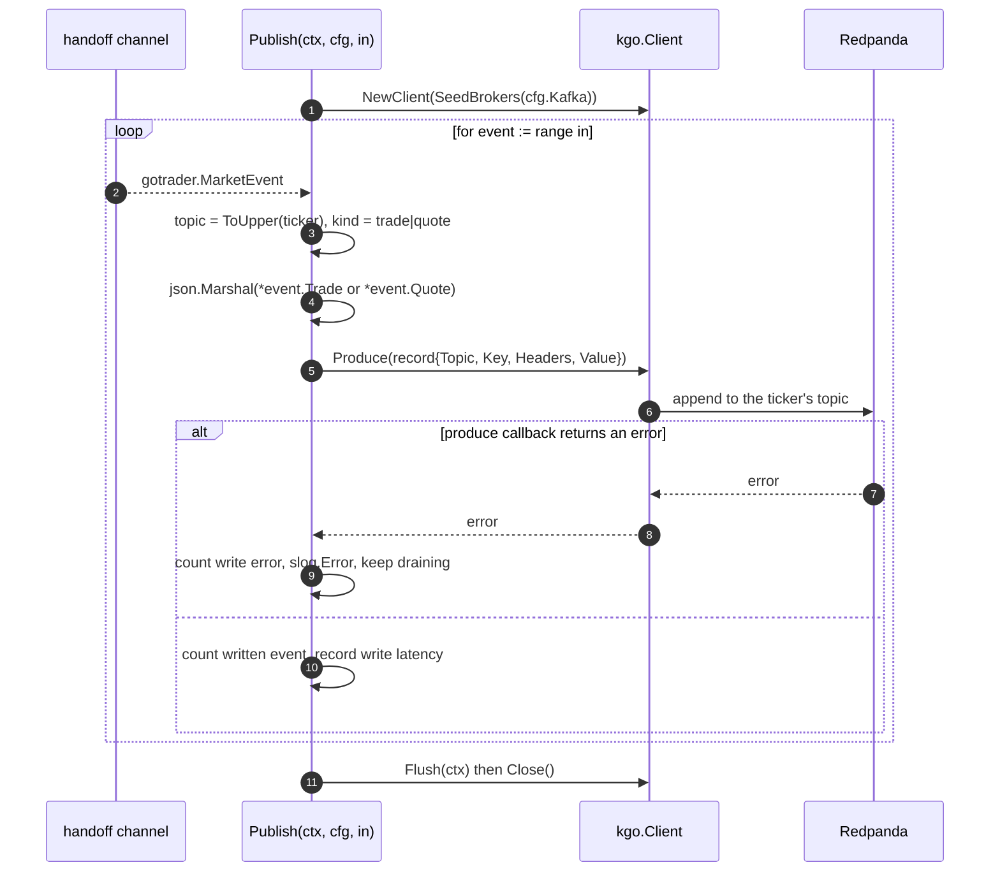

### TS-03 — Publish Market Events to Redpanda

## Index

| Section | Content |
|---|---|
| Header | Story fields |
| Functional Specification | Requirements, acceptance criteria, BDD |
| Technical Specification | Pointers, sequence, record shape, files, tips |
| Tasks | TASK-0301, UT-0301, E2E-0301 |
| Known gaps & open points | Durability and auto-creation |
| How to run these tests | Commands |
| Definition of Done | Checklist |

| Field | Value |
|---|---|
| **Type** | TS |
| **ID** | TS-03 |
| **Title** | Publish Market Events to Redpanda |
| **Architecture** | Messaging |
| **Category** | Integration |
| **Priority** | Must |
| **Epic** | EP-02 |
| **Archetype** | service-change |
| **Actor** | Quant Developer |
| **Workflow** | massive-ingest-pipeline |
| **Components** | `massive` |
| **Test Pyramid** | Unit, E2E |
| **Complexity** | Moderate |
| **Jira Issue ID** | |

---

## Functional Specification

**As a** Quant Developer, **I want** the second half of the pipeline to drain the handoff channel into Redpanda, one topic per ticker, **so that** any number of consumers can read the same live market data without opening their own vendor connection.

### Functional Requirements

1. The publish function reads market events from a channel and writes one record per event.
2. The destination topic is the event's ticker in uppercase, and nothing else is appended to the name.
3. Each record carries the ticker as its key, so all the events of one symbol keep their relative order.
4. Each record states whether it is a trade or a quote, without the consumer having to inspect the payload.
5. The record body is the framework's own trade or quote, serialised so that it can be read back and inspected with ordinary tooling.
6. A topic that does not exist yet is created on first use.
7. A write failure is counted and logged; the publish function keeps draining the channel.
8. When the input channel is closed the function flushes what it still holds, then returns.

### Acceptance Criteria

1. An event for ticker `aapl` is written to the topic `AAPL`.
   - Source evidence: `requirements/Massive_datafeed/analysis.md` · §9 `topic-name`, AS-4
2. A record read back from the topic exposes the ticker as its key and a trade-or-quote marker as a header.
   - Source evidence: `requirements/Massive_datafeed/analysis.md` · §9 `record-shape`
3. A record body read back from the topic deserialises into the same trade or quote that was published, field for field.
   - Source evidence: `requirements/Massive_datafeed/analysis.md` · §9 `record-shape`, AS-4
4. Publishing to a ticker whose topic does not exist creates that topic and the record is readable afterwards.
   - Source evidence: `requirements/Massive_datafeed/analysis.md` · §9 `topic-name`, A-4
5. With every broker unreachable, the write-error count rises and the publish function is still consuming its input channel afterwards.
   - Source evidence: `requirements/Massive_datafeed/analysis.md` · AS-6
6. The publish function can be exercised from a hand-built channel, with no Massive connection anywhere.
   - Source evidence: `requirements/Massive_datafeed/analysis.md` · AS-3

### BDD Scenarios

```gherkin
Feature: Publish market events to Redpanda

  Scenario: An event reaches the topic named after its ticker
    Given a reachable Redpanda cluster in REDPANDA_BROKERS
    And a channel holding one trade for "AAPL"
    When the Quant Developer runs `go test ./massive/ -run TestPublishToRedpanda -v`
    Then the function returns no error
    And the record is readable from the topic "AAPL" with key "AAPL"

  Scenario: The topic is created on first use
    Given a reachable Redpanda cluster
    And a ticker whose topic does not exist yet
    When the Quant Developer runs `go test ./massive/ -run TestPublishToRedpanda -v`
    Then the topic is created and the record is readable from it

  Scenario: An unreachable broker does not kill the publisher
    Given a broker address that refuses connections
    When the Quant Developer runs `go test ./massive/ -run TestPublishWriteErrors -v`
    Then the write error count has risen
    And the publish function is still draining its input channel

  Scenario: No broker, no test run
    Given REDPANDA_BROKERS is not set
    When the Quant Developer runs `go test ./massive/`
    Then the Redpanda test is skipped and the package still passes
```

---

## Technical Specification

> **Advisory only.** Non-binding; deviations get documented in the task implementation notes.

### Architecture Pointers

- `github.com/twmb/franz-go` is imported by this story and by TS-05 only. Pure Go, no cgo, chosen over `segmentio/kafka-go` and `confluent-kafka-go` (`analysis.md` grill round 1).
- The function signature takes the input channel, which is what makes AS-3 testable: it never learns where its events came from.
- Topic auto-creation is a broker-side setting (assumption A-4); the client only asks for an unknown topic and relies on `auto.create.topics.enable`.
- Delivery semantics are franz-go defaults. No explicit idempotence, no retry policy, no acknowledgement contract — `analysis.md` §11 `durability` records this as `unbudgeted`.

### Interaction Sequence



### Record shape

| Part | Value |
|---|---|
| Topic | `strings.ToUpper(string(event.Symbol()))` |
| Key | the same uppercase ticker |
| Header `kind` | `trade` or `quote` |
| Value | `encoding/json` of `gotrader.Trade` or `gotrader.Quote` |

### Key Files / Modules

| Repo | Module | Key Files | Change Type | Effort |
|---|---|---|---|---|
| gotrader | massive | `massive/producer.go` | Add | M |
| gotrader | massive | `massive/producer_test.go` | Add | S |
| gotrader | root | `go.mod`, `go.sum` | Modify | XS |

### Implementation Tips

- `Produce` is asynchronous with a callback. Counting the error inside the callback is what keeps the drain loop running, which is exactly AC-5.
- Compute the topic name once per event and reuse it for the key; deriving the key separately is how the two drift apart.
- `Flush` before `Close`, otherwise the last records of a shutdown are silently dropped and E2E-0301 will be flaky rather than failing.
- Marshal the pointed-to value, not the pointer, so the JSON is an object and not a nullable one.

---

#### TASK-0301 — Redpanda producer over the handoff channel

| Field | Value |
|---|---|
| **Type** | TASK |
| **ID** | TASK-0301 |
| **Title** | Redpanda producer over the handoff channel |
| **Architecture** | Messaging |
| **Category** | Integration |
| **Priority** | Must |
| Story | TS-03
| **Covers** | ---
| Task Kind | Dev |
| Test Level | --- |
| Jira Issue ID | |
| Repo | gotrader |
| Module | massive |
| Key Files | `massive/producer.go`, `go.mod` |
| Task Type | New |
| Complexity | M — asynchronous produce with callbacks, error accounting that must not break the drain loop, and a flush-then-close shutdown. |
| Hours | 4-6 |
| Dependencies | TASK-0101, TASK-0201 |
| Blocked By | --- |

**Coding Suggestions:**

- **Approach:** `Publish(ctx context.Context, cfg Config, in <-chan gotrader.MarketEvent) error` builds one `kgo.Client` for every topic, ranges over `in`, and produces asynchronously. Errors are handled in the produce callback so the loop never stalls.
- **Where to modify:** New file `massive/producer.go`; add `github.com/twmb/franz-go` to `go.mod`.
- **Code sketch:**
  ```go
  const (
      headerKind = "kind"
      kindTrade  = "trade"
      kindQuote  = "quote"
  )

  // Publish drains in and writes one record per event to the topic named after
  // the ticker. It is deliberately ignorant of where the events came from: that
  // is what lets it be tested without a Massive connection.
  func Publish(ctx context.Context, cfg Config, in <-chan gotrader.MarketEvent) error {
      client, err := kgo.NewClient(kgo.SeedBrokers(cfg.Kafka))
      if err != nil {
          return fmt.Errorf("massive: can not build the redpanda client: %w", err)
      }
      defer client.Close()

      for event := range in {
          record, err := recordFor(event)
          if err != nil {
              slog.Error("skipping an event that can not be serialized", "ticker", event.Symbol(), "error", err)
              continue
          }

          client.Produce(ctx, record, func(_ *kgo.Record, err error) {
              if err != nil {
                  slog.Error("can not write the event to redpanda", "topic", record.Topic, "error", err)
                  return
              }
          })
      }

      if err := client.Flush(ctx); err != nil {
          return fmt.Errorf("massive: can not flush the pending records: %w", err)
      }
      return nil
  }

  func recordFor(event gotrader.MarketEvent) (*kgo.Record, error) {
      topic := strings.ToUpper(string(event.Symbol()))
      if topic == "" {
          return nil, fmt.Errorf("massive: an event without a ticker has no topic")
      }

      kind, payload := kindTrade, any(event.Trade)
      if event.IsQuote() {
          kind, payload = kindQuote, any(event.Quote)
      }
      // ... json.Marshal the pointed-to value, build the record
  }
  ```
- **Patterns to reuse:** The error-wrapping style of `writeParquetTrades` in `datafeed.go`; `slog.Error` with key/value pairs as everywhere else in the repo.
- **Watch-out-for:** `Produce`'s callback runs on another goroutine, so anything it touches is shared state — the counters of TS-04 are safe, a plain `int` would not be. Also, returning from `Publish` on the first produce error would violate AC-5.
- **Test guidance:** AC-5 is provable without a broker (point the client at a closed port). AC-1..4 need a real Redpanda and belong to E2E-0301.

#### UT-0301 — Unit tests for record shape and the write-error path

| Field | Value |
|---|---|
| **Type** | TASK |
| **ID** | UT-0301 |
| **Title** | Unit tests for record shape and the write-error path |
| **Architecture** | Messaging |
| **Category** | Test: Unit |
| **Priority** | Must |
| Story | TS-03
| **Covers** | TS-03
| Task Kind | Test |
| Test Level | Unit |
| Jira Issue ID | |
| Repo | gotrader |
| Module | massive |
| Key Files | `massive/producer_test.go` |
| Task Type | Test |
| Complexity | S — one pure-function table plus one unreachable-broker case with a short timeout. |
| Hours | 2 |
| Dependencies | TASK-0301 |
| Blocked By | --- |
| Scenario Type | HP / ERR |
| BDD Ref | "An unreachable broker does not kill the publisher" |
| Implemented In | --- |
| Arrange | A trade and a quote event; separately, a config pointing at a port nothing listens on. The write-error count is the one instrumented in TS-04. |
| Act | Call the record builder; separately run `Publish` over a channel with a few events and a short context. |
| Assert | Topic, key, header and payload are as specified; on the unreachable broker the function drains every event and returns without panicking. |

**Test Skeleton:**

```go
func TestRecordShape(t *testing.T) {
    trade := gotrader.Trade{Ticker: "aapl", TS: 1, Price: 10, Size: 5}

    record, err := recordFor(gotrader.MarketEvent{Trade: &trade})
    if err != nil {
        t.Fatalf("recordFor() error = %v", err)
    }

    if record.Topic != "AAPL" {
        t.Errorf("topic = %q, want AAPL", record.Topic)
    }
    if string(record.Key) != "AAPL" {
        t.Errorf("key = %q, want AAPL", record.Key)
    }
    // assert the kind header is "trade" and the value round-trips to the same Trade
}

func TestPublishWriteErrors(t *testing.T) {
    ctx, cancel := context.WithTimeout(context.Background(), 5*time.Second)
    defer cancel()

    events := make(chan gotrader.MarketEvent, 3)
    // push three events, close the channel
    // Publish against 127.0.0.1:1 must drain all three and return, not hang
}
```

#### E2E-0301 — Write against a real Redpanda cluster

| Field | Value |
|---|---|
| **Type** | TASK |
| **ID** | E2E-0301 |
| **Title** | Write against a real Redpanda cluster |
| **Architecture** | Messaging |
| **Category** | Test: E2E |
| **Priority** | Must |
| Story | TS-03
| **Covers** | TS-03
| Task Kind | Test |
| Test Level | E2E |
| Jira Issue ID | |
| Repo | gotrader | 
| Module | massive |
| Key Files | `massive/producer_test.go` |
| Task Type | Test |
| Complexity | S — the requirement asks only that it runs without error; the read-back assertion is a cheap addition. |
| Hours | 2 |
| Dependencies | TASK-0301 |
| Blocked By | Needs a reachable Redpanda cluster |
| Scenario Type | HP |
| BDD Ref | "An event reaches the topic named after its ticker", "The topic is created on first use", "No broker, no test run" |
| Implemented In | --- |
| Arrange | Read `REDPANDA_BROKERS`; `t.Skip()` when unset. Build a channel with one trade and one quote for a throwaway ticker. |
| Act | Run `Publish` over that channel until it is closed. |
| Assert | No error is returned. As a bonus over the stated requirement, read the topic back and check key, header and payload. |

**Test Skeleton:**

```go
func TestPublishToRedpanda(t *testing.T) {
    broker := os.Getenv("REDPANDA_BROKERS")
    if broker == "" {
        t.Skip("REDPANDA_BROKERS is not set, skipping the redpanda write test")
    }

    ctx, cancel := context.WithTimeout(context.Background(), 30*time.Second)
    defer cancel()

    ticker := gotrader.Symbol(fmt.Sprintf("TEST%d", time.Now().UnixNano()))
    trade := gotrader.Trade{Ticker: ticker, TS: time.Now().UnixMilli(), Price: 1, Size: 1}

    events := make(chan gotrader.MarketEvent, 2)
    events <- gotrader.MarketEvent{Trade: &trade}
    close(events)

    cfg := Config{Kafka: broker}
    if err := Publish(ctx, cfg, events); err != nil {
        t.Fatalf("Publish() error = %v", err)
    }
}
```

---

**Known gaps & open points:**

- A-4 (`analysis.md` §15): auto-creation assumes the cluster allows it. Against a cluster with `auto.create.topics.enable=false` every write to a new ticker fails, and the only symptom is a rising write-error count.
- `analysis.md` §11 `durability`: delivery guarantees are `unbudgeted`. In practice this is at-most-once with franz-go's default retries, and a broker outage longer than those retries loses data with no replay path.
- E2E-0301 leaves a throwaway topic behind on every run; retention or a manual `rpk topic delete` is the operator's problem.

**How to run these tests:**

| Command | Covers | When to run |
|---|---|---|
| `go test ./massive/ -run 'TestRecordShape\|TestPublishWriteErrors' -v` | UT-0301 | Every change to `massive/producer.go` |
| `REDPANDA_BROKERS=localhost:9092 go test ./massive/ -run TestPublishToRedpanda -v` | E2E-0301 | Before merging, with a local Redpanda up |

**Definition of Done:**
- [ ] Code reviewed and merged
- [ ] Tests added or updated per Test Pyramid
- [ ] BDD scenarios passing
- [ ] Acceptance Criteria verified end-to-end
