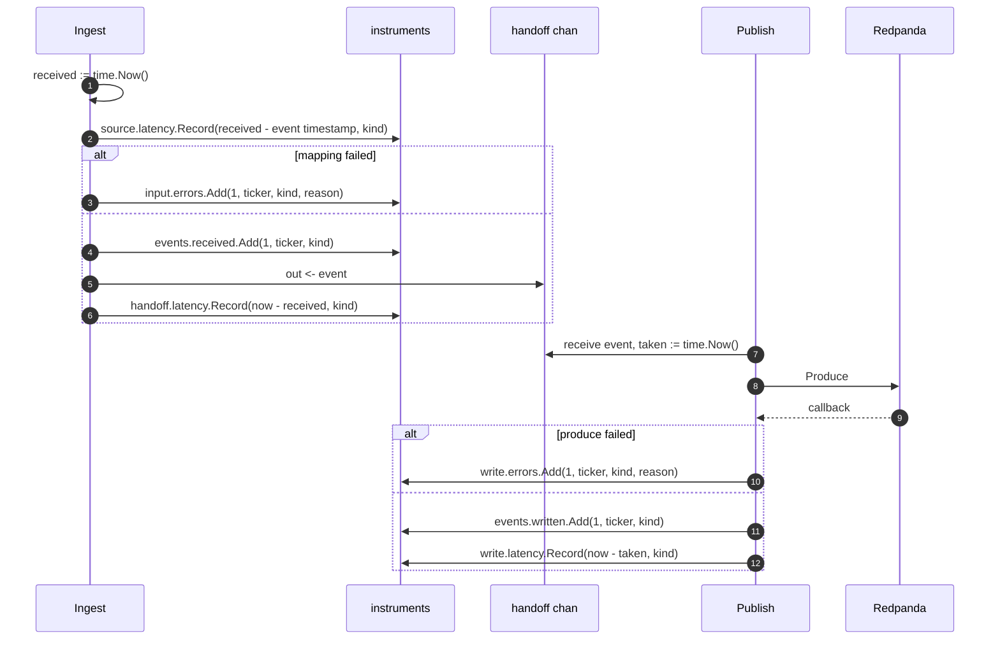

### TS-04 — OpenTelemetry Instrumentation of the Pipeline

## Index

| Section | Content |
|---|---|
| Header | Story fields |
| Functional Specification | Requirements, acceptance criteria, BDD |
| Technical Specification | Pointers, instrument table, sequence, files, tips |
| Tasks | TASK-0401, TASK-0402, UT-0401 |
| Known gaps & open points | Cardinality and clock skew |
| How to run these tests | Commands |
| Definition of Done | Checklist |

| Field | Value |
|---|---|
| **Type** | TS |
| **ID** | TS-04 |
| **Title** | OpenTelemetry Instrumentation of the Pipeline |
| **Architecture** | Observability |
| **Category** | Observability |
| **Priority** | Must |
| **Epic** | EP-02 |
| **Archetype** | quality-change |
| **Actor** | Quant Developer |
| **Workflow** | massive-ingest-pipeline |
| **Components** | `massive` |
| **Test Pyramid** | Unit |
| **Complexity** | Moderate |
| **Jira Issue ID** | |

---

## Functional Specification

**As a** Quant Developer, **I want** the pipeline to report what it received, what it wrote and how long each hop took, **so that** I can tell a quiet market from a broken feed without attaching a debugger to a process that has been running for hours.

### Functional Requirements

1. The pipeline reports, per ticker and per kind, how many trades and quotes it received from the vendor.
2. The pipeline reports, per ticker and per kind, how many events it wrote to Redpanda.
3. The pipeline reports, per ticker and per kind, how many inputs it could not use and how many writes failed, each with a reason.
4. The pipeline reports how long an event takes from arriving in the process to being handed to the publish half.
5. The pipeline reports how long an event takes from the timestamp the market put on it to arriving in the process.
6. The pipeline reports how long an event takes from being picked up by the publish half to being acknowledged by Redpanda.
7. The library only declares these measurements. It never decides where they are sent, never starts a server and never reads configuration to do so.

### Acceptance Criteria

1. Reading the pipeline's measurements yields exactly the seven named in the instrument table, no more and no fewer.
   - Source evidence: `requirements/Massive_datafeed/analysis.md` · §9.3, AS-7
2. Counts of received, written and failed events are broken down by ticker and by kind; a run touching two tickers yields separate figures for each.
   - Source evidence: `requirements/Massive_datafeed/analysis.md` · §9.3, §11 `cardinality`
3. The three duration measurements are broken down by kind only, and carry no ticker, whatever the number of tickers in the run.
   - Source evidence: `requirements/Massive_datafeed/analysis.md` · §11 `cardinality` — a per-ticker histogram over a large universe is tens of thousands of series
4. Importing and running the pipeline neither opens a listening port nor configures any destination for the measurements.
   - Source evidence: `requirements/Massive_datafeed/analysis.md` · §10 `otel-meter`, AS-7
5. With no destination configured by the caller, the pipeline still runs and produces market data normally.
   - Source evidence: `requirements/Massive_datafeed/analysis.md` · §10 `otel-meter` — the OTel default is a no-op provider

### BDD Scenarios

```gherkin
Feature: OpenTelemetry instrumentation of the pipeline

  Scenario: The declared measurement set is exactly the agreed one
    Given a collector that captures whatever the pipeline declares
    When the Quant Developer runs `go test ./massive/ -run TestInstruments -v`
    Then exactly the seven named measurements are collected

  Scenario: Counts are split per ticker, durations are not
    Given a run that handled trades for "AAPL" and for "MSFT"
    When the Quant Developer runs `go test ./massive/ -run TestInstruments -v`
    Then the received count has one figure per ticker
    And the latency measurements carry no ticker at all

  Scenario: The library configures no destination
    Given a process that never sets up an OpenTelemetry provider
    When the Quant Developer runs `go test ./massive/ -run TestInstruments -v`
    Then the pipeline runs without error
    And no port is opened by the package
```

---

## Technical Specification

> **Advisory only.** Non-binding; deviations get documented in the task implementation notes.

### Architecture Pointers

- Instruments are created on `otel.Meter("github.com/totomz/gotrader/massive")`, the global meter. If the process never installs a `MeterProvider`, OTel's default no-op takes over and nothing breaks — that is AC-5.
- No `sdk/metric`, no exporter and no `net/http` import in the package. The decision is on the record: *"gotrader è una libreria, ci pensa un main a fare il setup dell'exporter"* (`analysis.md` §18, round 6).
- The `sdk/metric` dependency appears in the test file only, to give UT-0401 a manual reader to collect against.
- Cardinality is the one design constraint: `ticker` on counters, never on histograms (`analysis.md` §11 `cardinality`).

### Instrument table

| Name | Kind | Unit | Attributes | Measured where |
|---|---|---|---|---|
| `massive.events.received` | Counter | `{event}` | `ticker`, `kind` | Ingest, after a successful mapping |
| `massive.events.written` | Counter | `{event}` | `ticker`, `kind` | Publish, in the produce callback on success |
| `massive.input.errors` | Counter | `{error}` | `ticker`, `kind`, `reason` | Ingest, on an unmappable frame |
| `massive.write.errors` | Counter | `{error}` | `ticker`, `kind`, `reason` | Publish, in the produce callback on failure |
| `massive.source.latency` | Histogram | `s` | `kind` | Ingest: event timestamp → local receive |
| `massive.handoff.latency` | Histogram | `s` | `kind` | Ingest: local receive → sent on the handoff channel |
| `massive.write.latency` | Histogram | `s` | `kind` | Publish: received from the handoff channel → produce acknowledged |

### Interaction Sequence



### Key Files / Modules

| Repo | Module | Key Files | Change Type | Effort |
|---|---|---|---|---|
| gotrader | massive | `massive/metrics.go` | Add | S |
| gotrader | massive | `massive/ingester.go`, `massive/producer.go` | Modify | S |
| gotrader | massive | `massive/metrics_test.go` | Add | S |
| gotrader | root | `go.mod`, `go.sum` | Modify | XS |

### Implementation Tips

- Build the instrument set once, in a constructor that returns a struct, and pass it to `Ingest` and `Publish`. Package-level globals would make UT-0401 order-dependent.
- The event timestamp is milliseconds since epoch from the vendor and the receive instant is a local wall clock: `source.latency` therefore carries the clock skew between us and the exchange, and can go negative. Clamp at zero and say so in the doc comment.
- `handoff.latency` must use the same `time.Now()` value as the one used for `source.latency`, otherwise the two measurements overlap and neither adds up.

---

#### TASK-0401 — Instrument set on the global meter

| Field | Value |
|---|---|
| **Type** | TASK |
| **ID** | TASK-0401 |
| **Title** | Instrument set on the global meter |
| **Architecture** | Observability |
| **Category** | Observability |
| **Priority** | Must |
| Story | TS-04
| **Covers** | ---
| Task Kind | Dev |
| Test Level | --- |
| Jira Issue ID | |
| Repo | gotrader |
| Module | massive |
| Key Files | `massive/metrics.go`, `go.mod` |
| Task Type | New |
| Complexity | S — seven declarations; the thinking is in the attribute choice, which is already settled. |
| Hours | 2-3 |
| Dependencies | TASK-0201 |
| Blocked By | --- |

**Coding Suggestions:**

- **Approach:** A `metrics` struct holding the seven instruments, built by `newMetrics() (*metrics, error)`, plus small helpers that hide the attribute sets from the call sites.
- **Where to modify:** New file `massive/metrics.go`; add `go.opentelemetry.io/otel` and `go.opentelemetry.io/otel/metric` to `go.mod`.
- **Code sketch:**
  ```go
  const meterName = "github.com/totomz/gotrader/massive"

  // metrics holds the instruments of the massive pipeline. The package creates
  // them on the global meter and nothing else: installing a MeterProvider and an
  // exporter is the job of the process that imports gotrader.
  // Cardinality rule: ticker only on counters, never on histograms.
  type metrics struct {
      received      metric.Int64Counter
      written       metric.Int64Counter
      inputErrors   metric.Int64Counter
      writeErrors   metric.Int64Counter
      sourceLatency metric.Float64Histogram
      handoffLatency metric.Float64Histogram
      writeLatency  metric.Float64Histogram
  }

  func newMetrics() (*metrics, error) {
      meter := otel.Meter(meterName)

      m := &metrics{}
      var err error
      if m.received, err = meter.Int64Counter("massive.events.received",
          metric.WithUnit("{event}"),
          metric.WithDescription("Trades and quotes received from the massive websocket")); err != nil {
          return nil, fmt.Errorf("massive: can not create the received counter: %w", err)
      }
      // ... the other six

      return m, nil
  }

  func (m *metrics) countReceived(ctx context.Context, ticker gotrader.Symbol, kind string) {
      m.received.Add(ctx, 1, metric.WithAttributes(
          attribute.String("ticker", string(ticker)),
          attribute.String("kind", kind),
      ))
  }
  ```
- **Patterns to reuse:** Nothing in the repo uses OTel yet; `go.opencensus.io` is a transitive dependency of the Alpaca client and must not be confused with it.
- **Watch-out-for:** Seven `err` checks in a row invite a copy-paste that creates two instruments with the same name. Test AC-1 by name, which is what UT-0401 does.
- **Test guidance:** Collect against a manual reader and compare the set of names; no exporter, no network.

#### TASK-0402 — Wire the instruments into ingest and publish

| Field | Value |
|---|---|
| **Type** | TASK |
| **ID** | TASK-0402 |
| **Title** | Wire the instruments into ingest and publish |
| **Architecture** | Observability |
| **Category** | Observability |
| **Priority** | Must |
| Story | TS-04
| **Covers** | ---
| Task Kind | Dev |
| Test Level | --- |
| Jira Issue ID | |
| Repo | gotrader |
| Module | massive |
| Key Files | `massive/ingester.go`, `massive/producer.go` |
| Task Type | Modify |
| Complexity | S — the call sites are few, but the two latency timers must be taken at the right instants or the numbers are meaningless. |
| Hours | 2-3 |
| Dependencies | TASK-0401, TASK-0301 |
| Blocked By | --- |

**Coding Suggestions:**

- **Approach:** Thread the `*metrics` through `Ingest` and `Publish`, take `received := time.Now()` as the first statement after a frame arrives and `taken := time.Now()` as the first statement after a receive from the handoff channel.
- **Where to modify:** The type-switch body of `massive/ingester.go` and the drain loop plus produce callback of `massive/producer.go`.
- **Code sketch:**
  ```go
  received := time.Now()
  kind := kindTrade
  // ...
  // The vendor timestamp is the exchange clock and ours is the local one, so
  // this delta carries the skew between the two and can come out negative.
  if skew := received.Sub(time.UnixMilli(event.TS())); skew > 0 {
      m.sourceLatency.Record(ctx, skew.Seconds(), metric.WithAttributes(attribute.String("kind", kind)))
  }

  out <- event
  m.countReceived(ctx, event.Symbol(), kind)
  m.handoffLatency.Record(ctx, time.Since(received).Seconds(), metric.WithAttributes(attribute.String("kind", kind)))
  ```
- **Patterns to reuse:** The `kindTrade` / `kindQuote` constants already introduced by TASK-0301, so the attribute value and the Kafka header can never disagree.
- **Watch-out-for:** The produce callback runs on another goroutine and closes over `record`; capture the ticker and kind into locals before the callback, or every error is attributed to whichever record happened to be last.
- **Test guidance:** UT-0301 and UT-0201 already drive the two error paths; once wired, assert the counters moved there rather than duplicating those tests here.

#### UT-0401 — Unit tests for the declared instrument set

| Field | Value |
|---|---|
| **Type** | TASK |
| **ID** | UT-0401 |
| **Title** | Unit tests for the declared instrument set |
| **Architecture** | Observability |
| **Category** | Test: Unit |
| **Priority** | Must |
| Story | TS-04
| **Covers** | TS-04
| Task Kind | Test |
| Test Level | Unit |
| Jira Issue ID | |
| Repo | gotrader |
| Module | massive |
| Key Files | `massive/metrics_test.go` |
| Task Type | Test |
| Complexity | S — a manual reader and a set comparison; the only subtlety is that a counter with no recorded value is not collected. |
| Hours | 2 |
| Dependencies | TASK-0401, TASK-0402 |
| Blocked By | --- |
| Scenario Type | HP / EC |
| BDD Ref | All three scenarios of TS-04 |
| Implemented In | --- |
| Arrange | A `sdkmetric.NewManualReader` installed as the global provider for the duration of the test, and one recorded value on every instrument for two tickers. |
| Act | Collect once through the manual reader. |
| Assert | The collected metric names are exactly the seven of the instrument table; counters carry `ticker` and `kind`; histograms carry `kind` only. |

**Test Skeleton:**

```go
func TestInstruments(t *testing.T) {
    reader := sdkmetric.NewManualReader()
    provider := sdkmetric.NewMeterProvider(sdkmetric.WithReader(reader))
    otel.SetMeterProvider(provider)
    t.Cleanup(func() { _ = provider.Shutdown(context.Background()) })

    m, err := newMetrics()
    if err != nil {
        t.Fatalf("newMetrics() error = %v", err)
    }

    ctx := context.Background()
    m.countReceived(ctx, "AAPL", kindTrade)
    m.countReceived(ctx, "MSFT", kindQuote)
    // record one value on each of the other five

    var collected metricdata.ResourceMetrics
    if err := reader.Collect(ctx, &collected); err != nil {
        t.Fatalf("Collect() error = %v", err)
    }

    want := []string{
        "massive.events.received", "massive.events.written",
        "massive.input.errors", "massive.write.errors",
        "massive.source.latency", "massive.handoff.latency",
        "massive.write.latency",
    }
    // assert the collected names are exactly want
    // assert the attribute keys per instrument: counters {ticker, kind}, histograms {kind}
}
```

---

**Known gaps & open points:**

- OP-2 (`analysis.md` §16): there is no reconnect counter, because reconnection was delegated to the vendor SDK. A feed that silently stops reconnecting shows up only as counters that stop rising, which no alert can distinguish from a closed market.
- `massive.source.latency` depends on clock agreement between this host and the exchange. A host with a drifting clock will report a latency that says more about NTP than about the feed.
- The `reason` attribute on the two error counters is unbounded if it ever carries a raw error string. Keep it to a small fixed set of values.
- `analysis.md` §11 `throughput` is `unbudgeted`, so no alerting thresholds are derived from these measurements here.

**How to run these tests:**

| Command | Covers | When to run |
|---|---|---|
| `go test ./massive/ -run TestInstruments -v` | UT-0401 | Every change to `massive/metrics.go` or to an instrument call site |

**Definition of Done:**
- [ ] Code reviewed and merged
- [ ] Tests added or updated per Test Pyramid
- [ ] BDD scenarios passing
- [ ] Acceptance Criteria verified end-to-end
