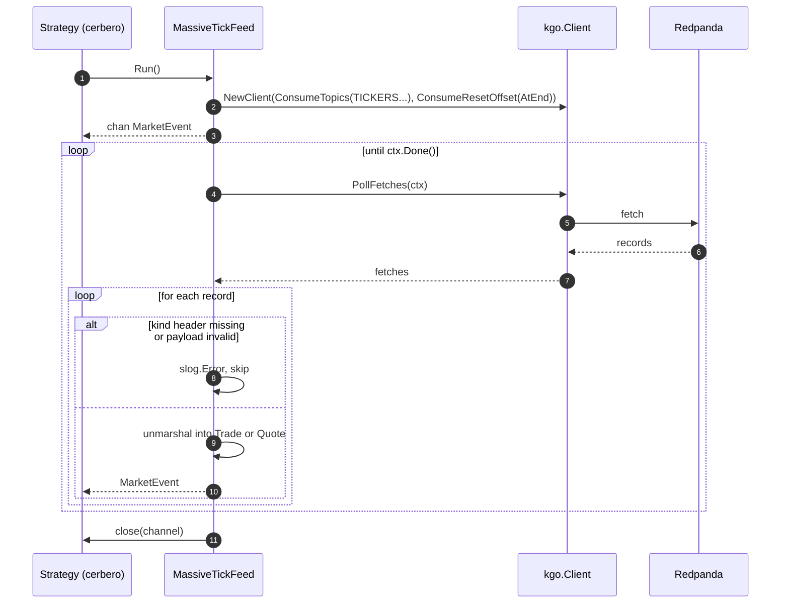

### TS-05 — MassiveTickFeed for Live Strategies

## Index

| Section | Content |
|---|---|
| Header | Story fields |
| Functional Specification | Requirements, acceptance criteria, BDD |
| Technical Specification | Pointers, ordering note, sequence, files, tips |
| Tasks | TASK-0501, E2E-0501 |
| Known gaps & open points | Ordering and offsets |
| How to run these tests | Commands |
| Definition of Done | Checklist |

| Field | Value |
|---|---|
| **Type** | TS |
| **ID** | TS-05 |
| **Title** | MassiveTickFeed for Live Strategies |
| **Architecture** | Strategy Runtime, Messaging |
| **Category** | Integration |
| **Priority** | Should |
| **Epic** | EP-02 |
| **Archetype** | service-change |
| **Actor** | Quant Developer |
| **Workflow** | massive-live-consumption |
| **Components** | `massive`, `tickfeed.go` |
| **Test Pyramid** | E2E |
| **Complexity** | Moderate |
| **Jira Issue ID** | |

---

## Functional Specification

**As a** Quant Developer, **I want** a tick feed that reads the live market data back out of Redpanda, **so that** a strategy written against the framework's feed interface can be run on the live market without being rewritten.

### Functional Requirements

1. The live feed presents itself to the framework exactly like any other tick feed, so an existing strategy consumes it unchanged.
2. The live feed reads the topics of the configured tickers and turns each record back into a trade or a quote market event.
3. The live feed starts from what is arriving now, not from the beginning of the retained history.
4. A record that cannot be turned back into a market event is logged and skipped; the feed keeps running.
5. The live feed guarantees only that timestamps do not go backwards for a single ticker. It does not order across tickers, and it does not place quotes before trades of the same instant.
6. The weaker guarantee is written down where the framework states the ordering contract, so nobody reads the strict contract and assumes it holds here.
7. The live feed stops cleanly when its context is cancelled and closes its channel.

### Acceptance Criteria

1. A strategy written against the framework's tick feed interface accepts the live feed with no change to the strategy.
   - Source evidence: `tickfeed.go` · `TickFeed` interface · `requirements/Massive_datafeed/analysis.md` §5 `consume-tickfeed`
2. Events published for a ticker are delivered by the live feed, carrying the same fields they were published with.
   - Source evidence: `requirements/Massive_datafeed/analysis.md` · AS-8, §9 `record-shape`
3. For any single ticker, the timestamps delivered never go backwards.
   - Source evidence: `requirements/Massive_datafeed/analysis.md` · AS-8
4. Events published before the feed started are not delivered.
   - Source evidence: `requirements/Massive_datafeed/analysis.md` · §15 A-3
5. The framework's stated ordering contract carries a note naming the live feed as an exception and stating what it guarantees instead.
   - Source evidence: `requirements/Massive_datafeed/analysis.md` · §8 `tickfeed-go`, grill round 4
6. A corrupt record in a topic does not end the feed: the following valid record is still delivered.
   - Source evidence: `requirements/Massive_datafeed/analysis.md` · §5 `consume-tickfeed`

### BDD Scenarios

```gherkin
Feature: MassiveTickFeed for live strategies

  Scenario: Published events come back out as market events
    Given a reachable Redpanda cluster in REDPANDA_BROKERS
    And a live feed started on a throwaway ticker
    When the Quant Developer runs `go test ./massive/ -run TestMassiveTickFeed -v`
    And a known sequence of trades and quotes is published for that ticker
    Then every event of the sequence is delivered on the feed channel
    And its fields match what was published

  Scenario: Timestamps never go backwards for one ticker
    Given a delivered sequence for a single ticker
    When the Quant Developer runs `go test ./massive/ -run TestMassiveTickFeed -v`
    Then each delivered timestamp is greater than or equal to the previous one

  Scenario: History is not replayed
    Given events published to a ticker before the feed is started
    When the Quant Developer runs `go test ./massive/ -run TestMassiveTickFeedStartsAtTheEnd -v`
    Then none of those earlier events is delivered

  Scenario: A corrupt record does not end the feed
    Given a topic holding a record that is not a valid market event, followed by a valid one
    When the Quant Developer runs `go test ./massive/ -run TestMassiveTickFeedSkipsBadRecords -v`
    Then the valid event is still delivered
```

---

## Technical Specification

> **Advisory only.** Non-binding; deviations get documented in the task implementation notes.

### Architecture Pointers

- `MassiveTickFeed` implements `gotrader.TickFeed` (`tickfeed.go`), so `cerbero.go` consumes it exactly as it consumes `GenericParquetTrades` or `SliceTickFeed`.
- It is a consumer, not a tee off the socket: the data path is always Massive → Redpanda → strategy. That is what lets several strategies share one vendor connection.
- The record shape is the one TS-03 writes: `kind` header decides which framework type to unmarshal into.
- franz-go with `kgo.ConsumeResetOffset(kgo.NewOffset().AtEnd())` implements assumption A-3.

### The ordering note

`tickfeed.go` documents four ordering rules: TS ascending, quote before trade at the same TS, Seq ascending, then ticker ascending. Over N partitions of N topics filled in real time none of rules 2 to 4 can hold, and rule 1 holds only within a ticker. The decision on the record is *"Ordine best-effort documentato"* (`analysis.md` §18, round 4), so this story writes the exception down rather than building the reordering buffer, which stays out of scope (`analysis.md` §3 `out-of-scope-reorder`).

```
  strict contract (parquet, backtest)      best-effort (massive, live)
  ┌──────────────────────────────┐         ┌──────────────────────────────┐
  │ TS ascending, globally       │         │ TS non-decreasing per ticker │
  │ quote before trade @ same TS │   vs    │ no cross-kind ordering       │
  │ Seq ascending                │         │ no cross-ticker ordering     │
  │ ticker ascending             │         │ partition order only         │
  └──────────────────────────────┘         └──────────────────────────────┘
```

### Interaction Sequence



### Key Files / Modules

| Repo | Module | Key Files | Change Type | Effort |
|---|---|---|---|---|
| gotrader | massive | `massive/tickfeed.go` | Add | M |
| gotrader | root | `tickfeed.go` | Modify | XS |
| gotrader | massive | `massive/tickfeed_test.go` | Add | S |

### Implementation Tips

- Keep the buffer of the returned channel at `tickFeedBufferSize`, the constant `tickfeed.go` already uses, so the feed behaves like the others under a slow strategy.
- `PollFetches` returns errors per topic-partition; log them and carry on, exactly as the parquet sources do when a file is unreadable.
- Topic names must be uppercased the same way TS-03 uppercases them. Share the helper instead of writing `strings.ToUpper` twice.
- Assumption A-3 makes the feed lossy by design on restart. If a strategy ever needs the gap, that is a new story with a consumer group, not a flag here.

---

#### TASK-0501 — Redpanda-backed tick feed and the ordering note

| Field | Value |
|---|---|
| **Type** | TASK |
| **ID** | TASK-0501 |
| **Title** | Redpanda-backed tick feed and the ordering note |
| **Architecture** | Strategy Runtime, Messaging |
| **Category** | Integration |
| **Priority** | Should |
| Story | TS-05
| **Covers** | ---
| Task Kind | Dev |
| Test Level | --- |
| Jira Issue ID | |
| Repo | gotrader |
| Module | massive |
| Key Files | `massive/tickfeed.go`, `tickfeed.go` |
| Task Type | New |
| Complexity | M — a poll loop, a per-record decode with a skip path, context-driven shutdown, plus a documentation change to an existing interface contract. |
| Hours | 4-6 |
| Dependencies | TASK-0301 |
| Blocked By | --- |

**Coding Suggestions:**

- **Approach:** `MassiveTickFeed` holds a `Config` and a context; `Run()` builds the consumer, starts one goroutine polling fetches and returns the channel, matching the shape of every other feed in the repo.
- **Where to modify:** New file `massive/tickfeed.go`; add the exception note to the `TickFeed` doc comment in the root `tickfeed.go`.
- **Code sketch:**
  ```go
  // MassiveTickFeed reads back the live stream that the massive ingester wrote
  // to redpanda, and presents it as a gotrader.TickFeed.
  //
  // Ordering: unlike the parquet feeds, this one does NOT honour the full
  // ordering contract of gotrader.TickFeed. Over several topics filled in real
  // time the only guarantee is that TS does not go backwards for a single
  // ticker. There is no cross-ticker ordering and no quote-before-trade rule.
  // See requirements/Massive_datafeed/analysis.md, AS-8.
  //
  // It starts from the end of each topic: whatever was published before Run()
  // is not delivered.
  type MassiveTickFeed struct {
      Ctx     context.Context
      Config  Config
      Tickers []gotrader.Symbol
  }

  func (f *MassiveTickFeed) Run() (chan gotrader.MarketEvent, error) {
      topics := make([]string, len(f.Tickers))
      for i, ticker := range f.Tickers {
          topics[i] = topicFor(ticker)
      }

      client, err := kgo.NewClient(
          kgo.SeedBrokers(f.Config.Kafka),
          kgo.ConsumeTopics(topics...),
          kgo.ConsumeResetOffset(kgo.NewOffset().AtEnd()),
      )
      if err != nil {
          return nil, fmt.Errorf("massive: can not build the redpanda consumer: %w", err)
      }

      stream := make(chan gotrader.MarketEvent, tickFeedBufferSize)
      go func() {
          defer close(stream)
          defer client.Close()

          for {
              fetches := client.PollFetches(f.Ctx)
              if fetches.IsClientClosed() || f.Ctx.Err() != nil {
                  return
              }

              fetches.EachError(func(topic string, partition int32, err error) {
                  slog.Error("can not fetch from redpanda", "topic", topic, "partition", partition, "error", err)
              })

              fetches.EachRecord(func(record *kgo.Record) {
                  event, err := eventFromRecord(record)
                  if err != nil {
                      slog.Error("skipping an unreadable record", "topic", record.Topic, "offset", record.Offset, "error", err)
                      return
                  }
                  stream <- event
              })
          }
      }()

      return stream, nil
  }
  ```
- **Patterns to reuse:** `SliceTickFeed.Run` and `GenericParquetTrades.Run` in `tickfeed.go` / `datafeed.go` — same `Run() (chan, error)` plus goroutine plus `defer close` shape.
- **Watch-out-for:** `tickFeedBufferSize` is unexported in package `gotrader`; the `massive` package needs its own constant with the same value, or the buffer silently differs from the rest of the framework.
- **Test guidance:** Everything worth proving here needs a real broker, so it all lands in E2E-0501.

#### E2E-0501 — Round trip through Redpanda into the tick feed

| Field | Value |
|---|---|
| **Type** | TASK |
| **ID** | E2E-0501 |
| **Title** | Round trip through Redpanda into the tick feed |
| **Architecture** | Strategy Runtime, Messaging |
| **Category** | Test: E2E |
| **Priority** | Should |
| Story | TS-05
| **Covers** | TS-05
| Task Kind | Test |
| Test Level | E2E |
| Jira Issue ID | |
| Repo | gotrader |
| Module | massive |
| Key Files | `massive/tickfeed_test.go` |
| Task Type | Test |
| Complexity | S — one produce-then-consume round trip, with the usual care about starting the consumer before publishing. |
| Hours | 2-3 |
| Dependencies | TASK-0501 |
| Blocked By | Needs a reachable Redpanda cluster |
| Scenario Type | HP / EC |
| BDD Ref | All four scenarios of TS-05 |
| Implemented In | --- |
| Arrange | Read `REDPANDA_BROKERS`; `t.Skip()` when unset. A throwaway ticker; start the feed and wait until it is consuming. |
| Act | Publish a known sequence of trades and quotes through `Publish`, then read the feed channel. |
| Assert | Every published event comes back with the same fields; per-ticker timestamps are non-decreasing; events published before `Run()` are absent. |

**Test Skeleton:**

```go
func TestMassiveTickFeed(t *testing.T) {
    broker := os.Getenv("REDPANDA_BROKERS")
    if broker == "" {
        t.Skip("REDPANDA_BROKERS is not set, skipping the tick feed round trip")
    }

    ctx, cancel := context.WithTimeout(context.Background(), 60*time.Second)
    defer cancel()

    cfg := Config{Kafka: broker}
    ticker := gotrader.Symbol(fmt.Sprintf("TEST%d", time.Now().UnixNano()))

    feed := &MassiveTickFeed{Ctx: ctx, Config: cfg, Tickers: []gotrader.Symbol{ticker}}
    stream, err := feed.Run()
    if err != nil {
        t.Fatalf("Run() error = %v", err)
    }

    // publish a known sequence of trades and quotes for ticker, then:
    var lastTS int64
    for i := 0; i < expected; i++ {
        select {
        case event := <-stream:
            if event.TS() < lastTS {
                t.Errorf("timestamp went backwards: %d after %d", event.TS(), lastTS)
            }
            lastTS = event.TS()
        case <-ctx.Done():
            t.Fatalf("only %d of %d events were delivered before the deadline", i, expected)
        }
    }
}
```

---

**Known gaps & open points:**

- A-3 (`analysis.md` §15): starting at the end means a restart loses whatever arrived while the process was down, with no way to ask for it. A consumer group with committed offsets would fix it and is not in this epic.
- `analysis.md` §3 `out-of-scope-reorder`: strategies that need quote-before-trade semantics, or a consistent cross-ticker clock, cannot use this feed as it stands. The reordering-window feed is a separate epic.
- The round-trip test needs the producer of TS-03 and therefore cannot run before it merges.
- Topic auto-creation applies to the consumer too: subscribing to a ticker that has never been published may create an empty topic, depending on cluster settings.

**How to run these tests:**

| Command | Covers | When to run |
|---|---|---|
| `REDPANDA_BROKERS=localhost:9092 go test ./massive/ -run TestMassiveTickFeed -v` | E2E-0501 | Before merging, with a local Redpanda up |

**Definition of Done:**
- [ ] Code reviewed and merged
- [ ] Tests added or updated per Test Pyramid
- [ ] BDD scenarios passing
- [ ] Acceptance Criteria verified end-to-end
